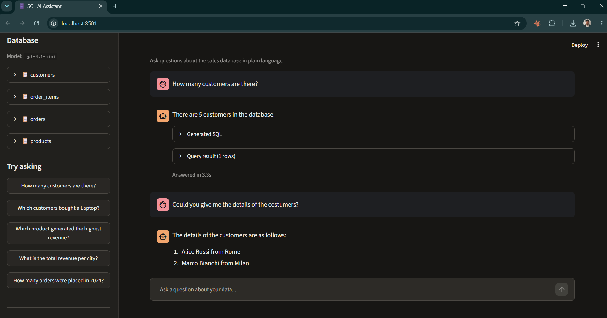

# SQL AI Assistant

Ask questions about your data in plain English and get answers straight from a SQL database.

SQL AI Assistant uses a LangChain SQL Agent and an OpenAI model to inspect the database schema, write the SQL query, run it and explain the result in natural language, from a web chat interface or the command line.


<p align="center">
  
</p>

---

## Table of Contents

- [Features](#features)
- [Quick Start](#quick-start)
- [Usage](#usage)
- [Example Queries](#example-queries)
- [How It Works](#how-it-works)
- [Architecture](#architecture)
- [Project Structure](#project-structure)
- [Configuration](#configuration)
- [Testing](#testing)
- [Tech Stack](#tech-stack)

## Features

**Natural language querying**
- Ask questions in plain language, no SQL knowledge required
- The agent explores tables and schemas on its own, without predefined queries
- Clear, human-readable answers

**Web interface**
- Chat interface built with Streamlit
- Generated SQL and query results shown for every answer
- Database schema browser and example questions in the sidebar

**Safety and reliability**
- Read-only database connection: the agent cannot modify data
- Layered architecture with custom exceptions and structured logging
- Configuration managed with Pydantic Settings
- Unit tests that run without calling the OpenAI API

## Quick Start

### Requirements

- Python 3.11+
- An OpenAI API key

### Installation

```bash
git clone https://github.com/francescomv98/sql-ai-assistant.git
cd sql-ai-assistant

python -m venv .venv
```

Activate the virtual environment:

```bash
# Windows
.venv\Scripts\activate

# Linux / macOS
source .venv/bin/activate
```

Install the dependencies:

```bash
pip install -r requirements.txt
```

### Environment variables

Create a `.env` file in the project root:

```env
OPENAI_API_KEY=your_openai_api_key
CHAT_MODEL=gpt-4.1-mini
```

See [Configuration](#configuration) for all available options.

## Usage

The sample database is created automatically on the first run.

### Web interface

```bash
streamlit run app.py
```

Open [http://localhost:8501](http://localhost:8501) in your browser. From the interface you can:

- ask questions in the chat;
- expand **Generated SQL** to see the query written by the agent;
- expand **Query result** to see the returned data as a table;
- browse the database tables and columns in the sidebar;
- start from one of the example questions.

### Command line

```bash
python main.py
```

```
Ask a question (or type 'exit'): How many customers are there?

SQL:
SELECT COUNT(*) AS customer_count FROM customers;

Answer:
There are 5 customers in the database.
```

Type `exit` or `quit`, or press `Ctrl+C`, to close the session.

## Example Queries

<details>
<summary><b>How many customers are there?</b></summary>

```sql
SELECT COUNT(*) AS customer_count
FROM customers;
```

> There are 5 customers in the database.

</details>

<details>
<summary><b>Which customers bought a Laptop?</b></summary>

```sql
SELECT DISTINCT
    c.id,
    c.first_name,
    c.last_name,
    c.city
FROM customers c
JOIN orders o
    ON c.id = o.customer_id
JOIN order_items oi
    ON o.id = oi.order_id
JOIN products p
    ON oi.product_id = p.id
WHERE p.name = 'Laptop';
```

> The customers who bought a Laptop are:
> - Alice Rossi from Rome
> - Marco Bianchi from Milan
> - Emma Brown from Paris

</details>

<details>
<summary><b>Which product generated the highest revenue?</b></summary>

```sql
SELECT
    p.name,
    SUM(oi.quantity * oi.unit_price) AS total_revenue
FROM order_items oi
JOIN products p
    ON oi.product_id = p.id
GROUP BY p.id
ORDER BY total_revenue DESC
LIMIT 1;
```

> The product that generated the highest revenue is the Laptop, with a total revenue of 8400.0.

</details>

<details>
<summary><b>What is the total revenue per city?</b></summary>

```sql
SELECT
    c.city,
    SUM(oi.quantity * oi.unit_price) AS total_revenue
FROM customers c
JOIN orders o
    ON c.id = o.customer_id
JOIN order_items oi
    ON o.id = oi.order_id
GROUP BY c.city;
```

> The total revenue per city is: London 4395.0, Milan 6550.0, Paris 4225.0, Rome 9145.0, Turin 3760.0.

</details>

## How It Works

1. The user asks a question in natural language.
2. The LangChain SQL Agent lists the available tables.
3. It retrieves the schema and sample rows of the relevant tables.
4. The LLM writes a SQLite query.
5. The query is checked and executed on a read-only connection.
6. The LLM interprets the result.
7. The final answer is returned together with the executed SQL.

```
"Which customers bought a Laptop?"
        |
        v
  LangChain SQL Agent
        |
        +--> List tables
        +--> Inspect schemas
        +--> Generate SQL query
        +--> Execute SQL query (read-only)
        +--> Interpret results
        |
        v
  Answer + executed SQL
```

The agent uses database tools to understand the available data at runtime instead of relying on predefined queries.

## Architecture

The application follows a layered architecture that separates the user interface, the application service, the AI agent and the data access layer.

```
     +-----------------+       +-----------------+
     |  Streamlit UI   |       |       CLI       |
     |    (app.py)     |       |    (main.py)    |
     +-----------------+       +-----------------+
              \                        /
               v                      v
              +------------------------+
              |       SQLService       |
              |  input validation and  |
              |    error handling      |
              +------------------------+
                          |
                          v
              +------------------------+
              |   LangChain SQL Agent  |
              |  reasoning, tool calls |
              |    and SQL generation  |
              +------------------------+
                  |               |
                  v               v
       +----------------+   +----------------+
       |   SQL Tools    |   |   OpenAI LLM   |
       |----------------|   +----------------+
       | List tables    |
       | Inspect schema |
       | Execute query  |
       +----------------+
                  |
                  v
       +--------------------+
       |  SQLite database   |
       |    (read-only)     |
       +--------------------+
```

### Main components

| Component | Location | Responsibility |
|---|---|---|
| Web interface | `app.py` | Chat UI, SQL and result display, schema browser |
| Command line | `main.py` | Interactive terminal session |
| SQL Service | `src/services/sql_service.py` | Validates questions and invokes the agent |
| SQL Agent | `src/agent/sql_agent.py` | Runs the LangChain agent, returns answer, SQL and timing |
| Database Manager | `src/database/database_manager.py` | Read-only SQLAlchemy engine, schema and query helpers |
| Database Initializer | `src/database/db_initializer.py` | Creates the SQLite database with sample data |
| OpenAI Client | `src/llm/openai_client.py` | Configures the chat model |
| Settings | `src/config/settings.py` | Loads configuration from `.env` |
| Utilities | `src/utils/` | Logging and custom exceptions |

### Sample database

The generated SQLite database contains sales data:

| Table | Description |
|---|---|
| `customers` | 5 customers with name and city |
| `products` | 10 products with category and price |
| `orders` | 30 orders between November 2023 and March 2025 |
| `order_items` | Products, quantities and unit prices for each order |

## Project Structure

```
sql-ai-assistant/
│
├── app.py                          # Streamlit web interface
├── main.py                         # Command line entry point
│
├── src/
│   ├── agent/
│   │   └── sql_agent.py            # LangChain SQL Agent
│   ├── config/
│   │   └── settings.py             # Application configuration
│   ├── database/
│   │   ├── database_manager.py     # Database connection and queries
│   │   └── db_initializer.py       # Database creation and sample data
│   ├── llm/
│   │   └── openai_client.py        # OpenAI model configuration
│   ├── services/
│   │   └── sql_service.py          # Application service layer
│   └── utils/
│       ├── exceptions.py           # Custom exceptions
│       └── logger.py               # Logging configuration
│
├── tests/
│   ├── conftest.py                 # Test environment setup
│   ├── test_database.py            # Database tests
│   └── test_sql_service.py         # Service and agent tests
│
├── database/                       # Generated SQLite database
├── docs/                           # Screenshots
├── .env                            # Environment variables (not committed)
├── requirements.txt
└── README.md
```

## Configuration

Settings are loaded from the `.env` file or from environment variables.

| Variable | Required | Default | Description |
|---|---|---|---|
| `OPENAI_API_KEY` | Yes | | OpenAI API key |
| `CHAT_MODEL` | Yes | | OpenAI chat model, e.g. `gpt-4.1-mini` (`OPENAI_MODEL` is also accepted) |
| `DATABASE_PATH` | No | `database/sales.db` | Path of the SQLite database |
| `LOG_LEVEL` | No | `INFO` | Logging level. Use `DEBUG` to print the agent reasoning and the executed SQL |

## Testing

```bash
pytest
```

The test suite covers:

- database creation and cleanup after a failed setup;
- read-only database access;
- schema and query helpers;
- service layer validation and error handling;
- extraction of the executed SQL from the agent workflow.

The tests use a temporary database and do not call the OpenAI API, so no API key is needed.

## Tech Stack

| Area | Technologies |
|---|---|
| Language | Python |
| AI / LLM | LangChain, LangChain SQL Agent, OpenAI API |
| Interface | Streamlit |
| Database | SQLite, SQLAlchemy |
| Configuration | Pydantic Settings |
| Testing | Pytest |
